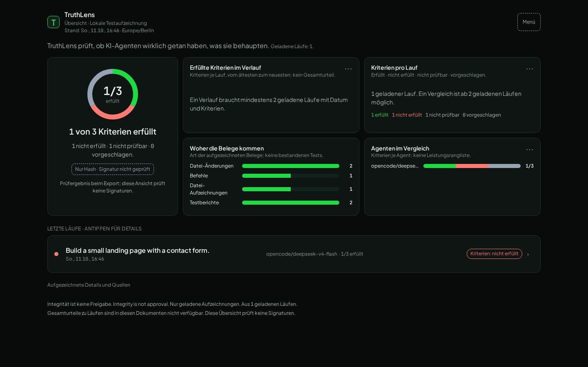

# TruthLens

[](https://github.com/Shuwajaja/truthlens/actions/workflows/ci.yml) [](docs/spec/event-schema-v1.md) [](LICENSE)

TruthLens records what an AI agent did and shows which of its claims are backed by recorded evidence.



The viewer UI is German. These supplied Chromium captures show the current viewer
with a local recorded test run, not a live service. The grey seal means
“Hash only · signature not checked”; **Integrity is not approval**.
[Run detail: claims and evidence](docs/screenshots/readme/truthlens-run-detail-desktop.png)
· [Mobile overview](docs/screenshots/readme/truthlens-overview-mobile.png)
· [Mobile run detail](docs/screenshots/readme/truthlens-run-detail-mobile.png).

## Try it in 1 minute

From a fresh clone, with **Python 3.12+**, run these commands in the repository
root. No package installation, API key, agent or network connection is needed:

```bash
PYTHONPATH=src python3 -m truthlens report demo/runs/demo-2
PYTHONPATH=src python3 -m truthlens verify demo/runs/demo-2/ledger.jsonl
```

This reads a committed **real OpenCode recording**. Expect `c1 met` (page exists),
`c2 unmet` (email validation), and `c3 unverified` (mobile layout). The report
shows the agent's three claims alongside their evidence; it does not rerun the
agent or tests. The ledger check reports `OK 16 events, anchored`. Both commands
check hashes without a signing key; they do **not** authenticate the recorder.
See [recorded demo provenance](docs/DEMO-RUNS.md).

To explore the viewer, use **Node 24** (the CI version):

```bash
cd viewer
npm ci
npm run dev -- --host 127.0.0.1
```

Open the loopback URL Vite prints. Development loads the committed
[recorded demo export](viewer/fixtures/demo-run.json); no new run is started.
**`npm ci` normally needs network access on a fresh clone**; it can work offline
only with all locked packages already cached. With dependencies installed, the
viewer runs locally. Installation time is outside the one-minute CLI path.

## How it works

- **Record:** a Python CLI wraps an agent command and captures output, file
  changes, test reports and claims. OpenCode is the v1 capture adapter.
- **Package:** redact secrets before hashing, then store events in a hash-chained
  ledger and files as content-addressed blobs with an artifact manifest.
- **Verify:** check the ledger, manifest and referenced artifacts; optionally
  authenticate with HMAC. Invalid evidence fails closed.
- **Review:** export results to the React viewer, separating criteria, agent
  claims, evidence and human approval. Client Lens explains; Developer Lens
  exposes events and details.

## What it does not do

- It cannot prove that an agent's work is correct or complete. A `met` criterion
  means the restored test command TruthLens started reported success; application
  code inside that test process can forge the result (accepted v1 limit).
- **Tamper detection holds only while the HMAC key stays with the human and the
  agent runs as a separate Unix user.** A same-UID agent can read the key and
  forge records or approve itself. The approval gate is not a sandbox: it controls
  capabilities routed through it, not the agent's unrestricted shell.
- The browser does **not** verify hashes or signatures itself. It displays
  export-time results; a consistently forged export can still be displayed.
  Hash-only integrity does not authenticate a signer, and integrity is not approval.
- v1 does not provide hosted storage/sync, multi-user billing, agent
  orchestration, multiple capture adapters, write access over MCP, or a remote
  MCP endpoint. Preview comments are not fed back to agents.

## For reviewers

The core is **Python 3.12+ with no runtime dependencies**; the viewer uses
**React, TypeScript and Vite**. Ledger and blob storage are authoritative;
SQLite is a disposable read projection. The repository includes tampering,
redaction, approval replay, wrapper isolation, audit and read-boundary regressions.

For code entry points, CLI commands, test instructions, fresh capture and
screenshot workflows, see the [reviewer guide](docs/REVIEWER-GUIDE.md).
For completion evidence and remaining limits, use [STATUS](docs/STATUS.md).
Green fast CI is not evidence of live isolation or a complete browser release.

## Quickstart: record your own run

The [demo task](docs/DEMO-TASK.md) defines a landing-page task with deliberately
separate page, validation and mobile criteria. The [demo script](demo/run-demo.sh)
can record a scripted offline agent or a real OpenCode run; prerequisites and
expected outcomes are in the [capture guide](docs/REVIEWER-GUIDE.md#fresh-capture).
The scripted agent is simulated, and running the script does not create a real
user's approval. Real-agent capture needs OpenCode and provider access.

A local production build starts **Not connected** and bundles no development
fixture. You can explicitly open local exports/folders or connect to a configured
private reader. Live reader setup and activation are separate from the demo;
see the [access boundary](docs/SELFHOST-MCP.md).

## Architecture

Start with [wrapper.py](src/truthlens/wrapper.py) for capture,
[ledger.py](src/truthlens/ledger.py) and [manifest.py](src/truthlens/manifest.py)
for integrity, [export.py](src/truthlens/export.py) for viewer data, and
[App.tsx](viewer/src/App.tsx) for presentation.

The legacy read-only evidence MCP exposes reports and events to human clients.
The separate **G1 broker / D34 status-only adapter** exposes bounded status to
agents; it never falls back to legacy evidence access. See
[architecture](docs/ARCHITECTURE.md), [status client setup](docs/AGENT-SETUP.md)
and [broker boundaries](docs/SELFHOST-MCP.md).

## Security and contracts

Canonical JSON excludes floats; `[REDACTED]` replaces secrets before hashing;
events chain by `seq`; writes use a single writer and fsync. Human-only
`approval.granted` and `criteria.confirmed` events cannot be replaced by agent
decisions. Approval binds an exact action, expires, and is single use.

These contracts are frozen: [event schema and decisions](docs/spec/event-schema-v1.md),
[artifact manifest](docs/spec/artifact-manifest-v1.md), and
[trust levels](docs/TRUST-LEVELS.md). The [read-only audit contract](docs/spec/audit-verifier-v1.md)
describes supported conclusions and unavailable checks; hash-only audits cannot
exit successfully. See the security limits above before treating any result as trust.

## Docs

- [Documentation index](docs/README.md) — all living references
- [Reviewer guide](docs/REVIEWER-GUIDE.md) — CLI, tests, capture and visual review
- [Current status](docs/STATUS.md) · [Demo task](docs/DEMO-TASK.md)
- [Viewer design](viewer/DESIGN.md) · [Wrapper design](docs/WRAPPER-DESIGN.md)
- [Inventory and provenance](docs/INVENTORY.md)

## License

[MIT](LICENSE). Reused sources and licenses are recorded in the
[inventory](docs/INVENTORY.md).
