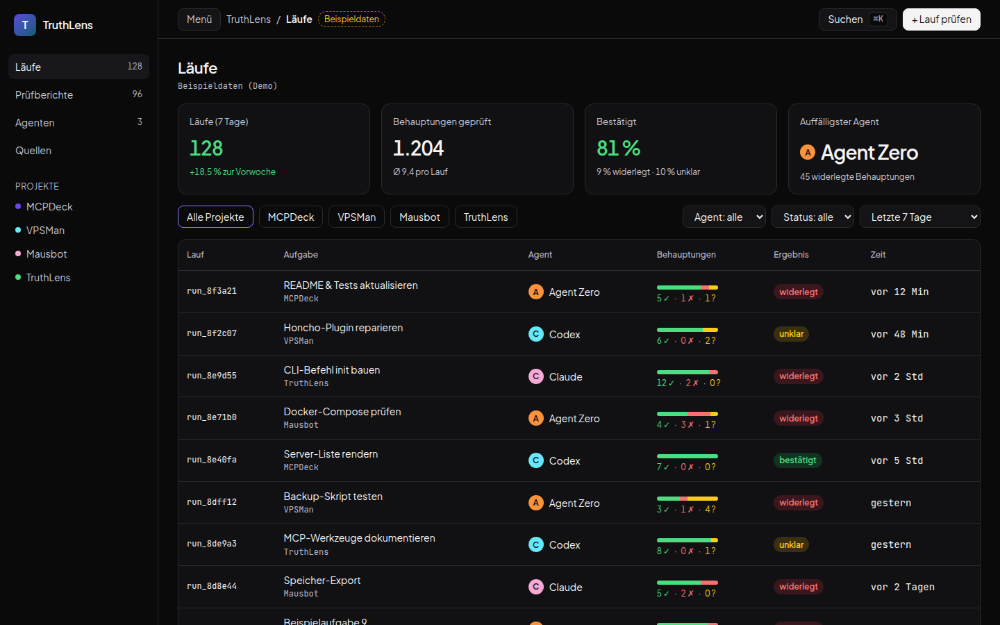
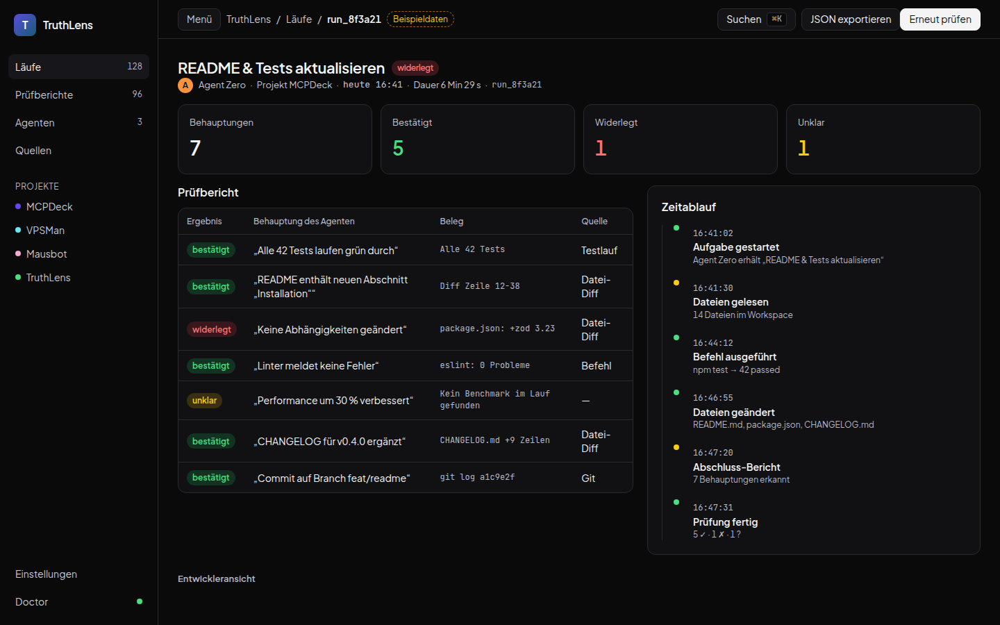
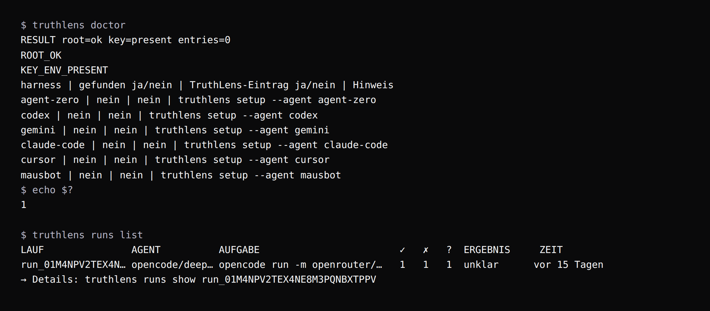
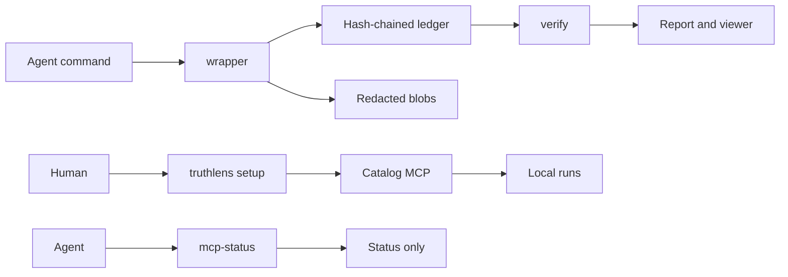

# TruthLens

[](https://github.com/Shuwajaja/truthlens/actions/workflows/ci.yml) [](https://www.python.org/downloads/) [](LICENSE)

Verifies what AI coding agents claim.





The viewer UI is German. These Chromium captures show the reference runs view
with labelled sample data, not a live service and not a signature check.
Green and red words require HMAC. **Integrity is not approval.**
[German guide](docs/de/README.md).



In that capture, `truthlens doctor` exits 1 because no harness entry is
installed. `truthlens runs list` prints unklar because the recorded run
is hash-only. The key value is not shown.

## Why

An agent can say the tests passed, a file changed, or a bug is fixed.
TruthLens keeps the record of the command, the files, the test output and
the claims, then shows which claims that record supports. A supported claim
is not a release decision. Integrity is not approval.

## How verification works

1. **Record.** A Python CLI wraps an agent command and stores output, file
   changes, test reports and claims. OpenCode is the v1 capture adapter.
2. **Seal.** Secrets are replaced with `[REDACTED]` before hashing. Events
   form a hash chain. An optional HMAC key stays with the human and is not
   written into the ledger.
3. **Check.** Verification recomputes the chain and, when a key is supplied,
   the HMAC. A bad chain fails closed. Hash-only means the bytes were not
   authenticated.
4. **Show.** Confirmed and refuted require HMAC. The viewer and
   `truthlens runs list` say bestätigt, widerlegt, and unklar. The report
   and the catalog MCP say `TRUE`, `FALSE`, and `UNKNOWN`. Without HMAC
   the result stays unklar or `UNKNOWN`, including when a stored summary
   says confirmed or refuted. One refuted HMAC claim is refuted. A
   doubtful test stays unklar. The browser does not compute the HMAC.

### What it does not do

- It does not prove that the work is correct or complete. A met criterion
  means the restored test command reported success. Code inside that test
  process can still forge the result.
- Tamper detection holds only while the HMAC key stays with the human and
  the agent runs as a separate user. A same-user agent can read the key.
  Isolation on a host is not claimed here.
- The browser displays the export. It does not verify hashes or signatures.
  A consistently forged export can still be shown.
- This repository does not provide hosted sync, billing, agent
  orchestration, write access over MCP, or a remote MCP endpoint.

## Quickstart

From a fresh clone, with Python 3.12+, run these commands in the repository
root. No package installation, API key, agent or network connection is needed.

**macOS / Linux (Bash):**

```bash
PYTHONPATH=src python3 -m truthlens report demo/runs/demo-2
PYTHONPATH=src python3 -m truthlens verify demo/runs/demo-2/ledger.jsonl
```

**Windows (PowerShell):** with Python 3.12+ available through the `py` launcher:

```powershell
$env:PYTHONPATH = "src"
py -3 -m truthlens report demo/runs/demo-2
py -3 -m truthlens verify demo/runs/demo-2/ledger.jsonl
```

This sets `PYTHONPATH` for the current PowerShell session. If your Python
installation provides `python` instead of `py`, replace `py -3` with `python`
in both commands, using Python 3.12+.

This reads a committed real OpenCode recording. Expect `c1 met` (page exists),
`c2 unmet` (email validation), and `c3 unverified` (mobile layout). The report
shows the agent's three claims alongside their evidence. It does not rerun the
agent or the tests. The ledger check reports `OK 16 events, anchored`. Both
commands check hashes without a signing key. They do not authenticate the
recorder. See [recorded demo provenance](docs/DEMO-RUNS.md).

### Set up your own harness

Install from the checkout, then print an MCP entry. The command stores the
environment variable name, not the key. `<path>` is your runs directory.
`/path/to/local/runs` in the printed entry is a placeholder.

```bash
python3 -m venv .venv
. .venv/bin/activate
pip install -e .
truthlens setup --agent cursor --root /path/to/local/runs --key-env TRUTHLENS_HMAC_KEY --print
truthlens doctor
```

`pip install` needs network access on a fresh machine. `--print` does not
write a file. `--write` copies an existing config to `.bak` first. Ask before
writing. Set `TRUTHLENS_HMAC_KEY` yourself. Without that key, verdicts stay
`UNKNOWN`. The same flags work for `codex`, `claude-code`, `gemini`,
`agent-zero` and `mausbot`. Agent Zero and Mausbot need `--config` because
TruthLens does not guess their folders. The full copy-paste guide is
[Set up TruthLens](docs/setup-mcp.md).

The viewer uses Node. Development setup, capture and screenshot checks are
in the [reviewer guide](docs/REVIEWER-GUIDE.md).

## MCP

`truthlens mcp` reads `TRUTHLENS_ROOT` and speaks newline JSON-RPC on stdio.
It does not open a socket and it does not write. Tools are `list_runs`,
`get_run` (claims, verdicts, evidence), `verify_run` (a local ledger or run
directory) and `doctor`. `TRUE` / bestätigt and `FALSE` / widerlegt appear
only when integrity is `hmac`. Hash-only results stay `UNKNOWN` / unklar.
A file that cannot be checked is `not_checkable`. Integrity is not approval.
Pass `--hmac-key-env VAR` only when that variable already holds the key.
The examples below set no key. `--root` still selects the older human
evidence tools and is not this catalog.

`truthlens mcp-status` is a different server. It exposes one status tool and
must not fall back to the catalog or to the legacy evidence tools.

[Agent Zero example](integrations/agent-zero/mcp-servers.example.json) ·
[Mausbot example](integrations/mausbot/mcp-servers.example.json). Both use a
placeholder root. They are not a live host configuration.

## Architecture



The catalog and the status adapter are separate. The status result is only
`passed`, `failed` or `not_checkable`. It does not carry claims, paths or
keys. Start with [wrapper.py](src/truthlens/wrapper.py),
[ledger.py](src/truthlens/ledger.py),
[manifest.py](src/truthlens/manifest.py) and
[App.tsx](viewer/src/App.tsx). The component map is
[architecture](docs/ARCHITECTURE.md). Frozen contracts:
[event schema](docs/spec/event-schema-v1.md),
[artifact manifest](docs/spec/artifact-manifest-v1.md) and
[trust levels](docs/TRUST-LEVELS.md).

## Roadmap

Already in this repository:

- Local capture, a hash-chained ledger, and optional HMAC.
- The offline report and verify commands above.
- A reference runs view and the evidence viewer.
- A read-only local catalog MCP, `truthlens setup`, and `truthlens doctor`.

Not in this repository:

- A qualified separate-user host. Isolation stays unverified.
- Hosted storage, sync, billing or a remote MCP endpoint.
- MCP tools that write.
- Capture adapters beyond OpenCode for v1.

Green CI is not evidence of live isolation or a complete browser release.
Measured limits are in [STATUS](docs/STATUS.md).

## License

[MIT](LICENSE). Reused sources and licenses are recorded in the
[inventory](docs/INVENTORY.md).
