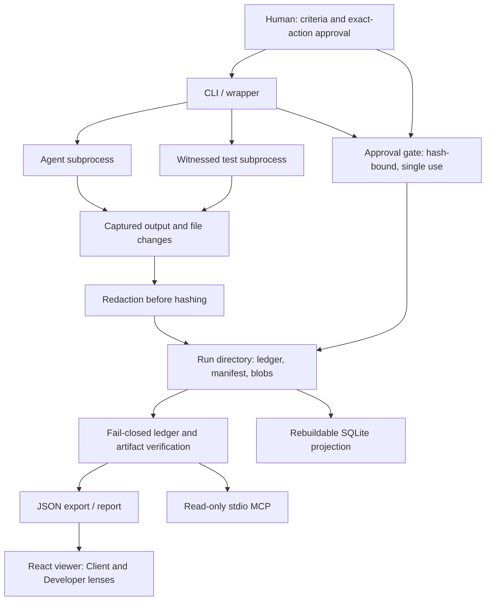
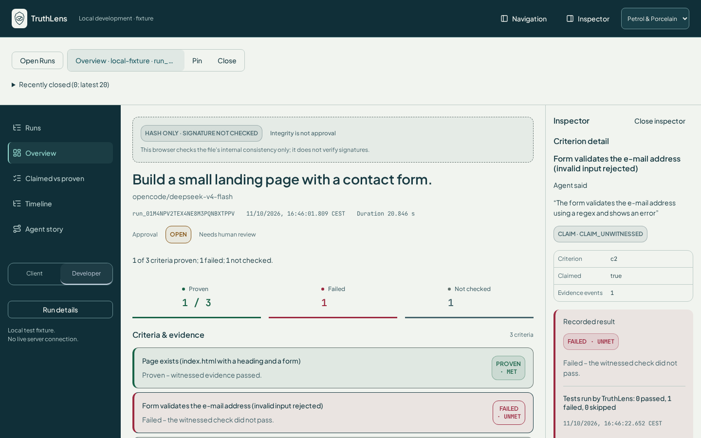
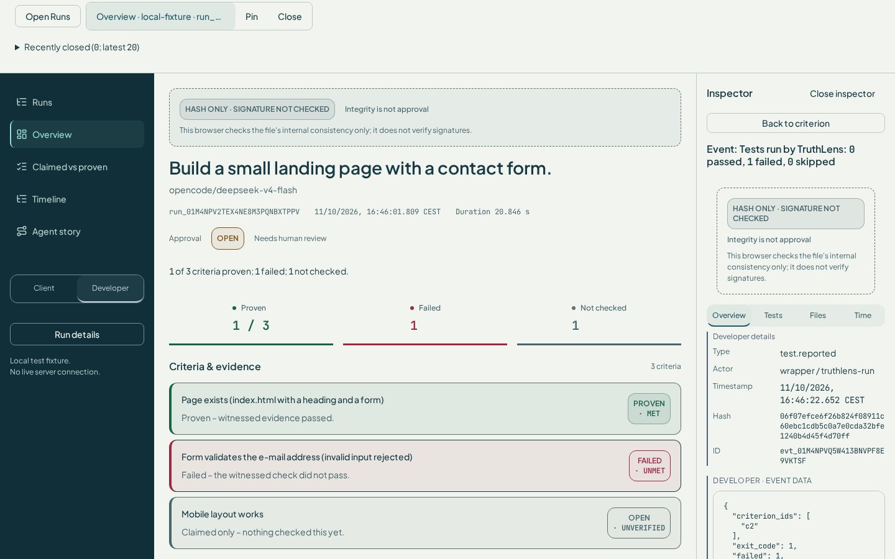
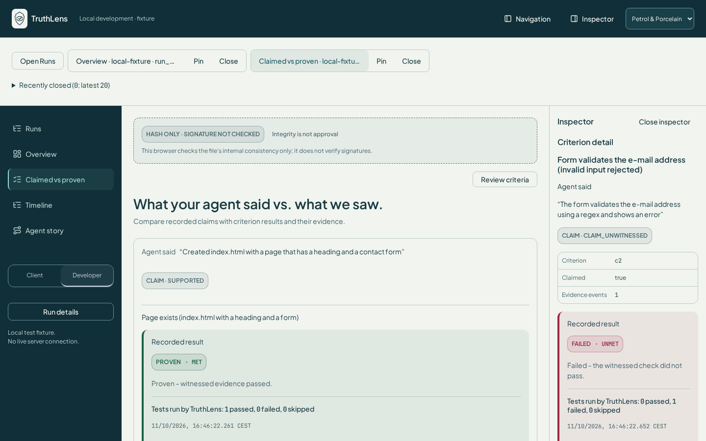
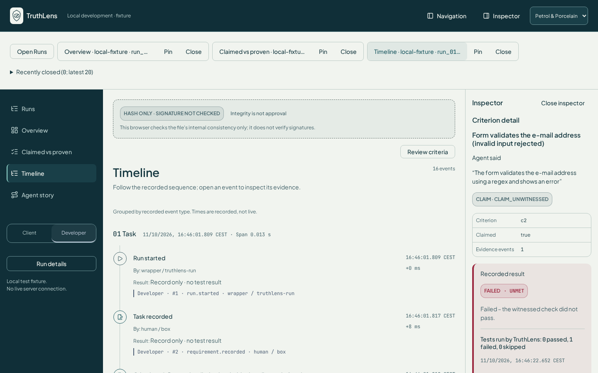
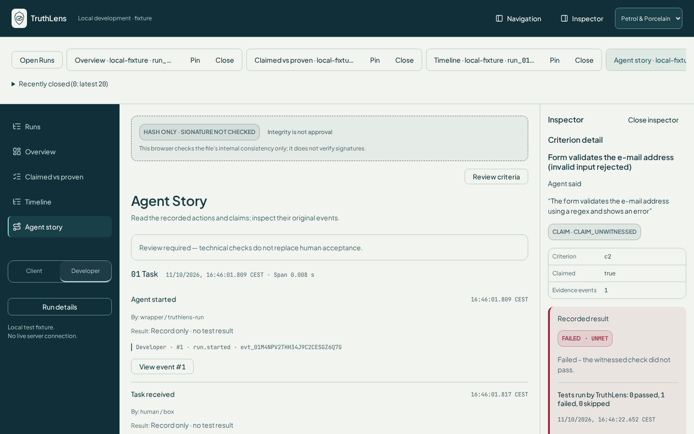
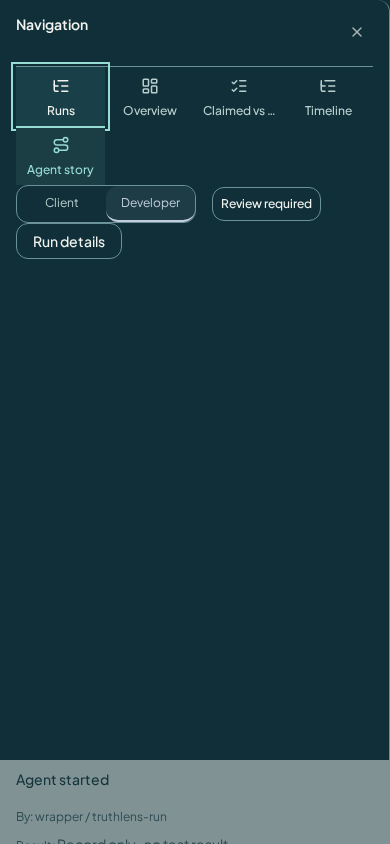

# TruthLens

[](https://github.com/Shuwajaja/truthlens/actions/workflows/ci.yml) [](docs/spec/event-schema-v1.md) [](LICENSE)

**See what your AI agent really did.**  
*Here's what's actually proven.*

For vibe coders and anyone handing work to AI agents — coding, research, writing, admin. Agents produce documents, file changes, visited sources, sent messages, commands and test runs scattered across terminals and folders, and then *tell* you it went well. TruthLens records a run as a self-contained work package — events in a hash-chained, HMAC-signed ledger, artifacts with a manifest, evidence, approvals — and shows it in plain language: *"You asked for X — done, witnessed by Y"* or *"claimed, not witnessed"* (Client Lens, primary view), with a Developer Lens for full detail. The v1 capture adapter is OpenCode (code work); the model is agent- and task-agnostic. It is honest about what it can prove — see the [Security promise (v1)](#security-promise-v1) below.

## Security promise (v1)

> Tamper detection holds only while the HMAC key stays with the human and the agent runs as a separate Unix user.
> "met" means: the restored test command that TruthLens started reported success; app code running in the test process can forge it (accepted v1 limit).

## For reviewers

TruthLens is a local-first evidence recorder for AI-agent work. Its Python CLI
captures commands, file changes, test reports and agent claims in a portable run
directory. The React viewer separates recorded evidence from claims and human
approval. The core uses the Python standard library; the browser presents exported
verification results and does **not** verify signatures itself.

**Run locally** with Python 3.12+ and Node 24:

```bash
python3 -m venv .venv
. .venv/bin/activate
pip install -e '.[dev]'
cd viewer
npm ci
npm run dev -- --host 127.0.0.1
```

Open the loopback URL printed by Vite. Development serves the committed
`viewer/fixtures/demo-run.json`; no API key or new agent run is needed. This is
recorded demo data, not a live service. For a fresh scripted capture, use the
[offline quickstart](#quickstart-reproducible-demo) below. A production build
starts **Not connected** and requires an explicit Connect action to the private
reader; it never bundles the development fixture.

**Tests** (from the repository root after activating the virtual environment):

```bash
pytest -q -ra
ruff check src tests
cd viewer
npm test
npm run lint
npm run build
node --test ../integrations/agent-zero-acp/audit-status.test.cjs
```

The Python suite includes tampering, redaction, approval replay, wrapper isolation,
read-only APIs and projection regressions. `tests/test_round5.py` also checks that
MCP withholds reports and timelines for a wrong signing key or a truncated ledger.
Separate-UID tests skip when their local user/sudo prerequisites are unavailable;
the documented same-UID attack is an expected failure. Neither is a security pass.
`npm test` includes the retained toolbar build matrix and all Vitest tests; it is
broader than fast PR CI. Browser screenshots and axe are separate manual checks.

**Architecture:** the ledger and artifact store are the source of evidence;
SQLite is a rebuildable projection. Start with `wrapper.py` for capture,
`ledger.py` / `manifest.py` for verification, `export.py` / `mcp.py` for read paths,
and `viewer/src/App.tsx` for presentation.



**Design decisions:** canonical JSON excludes floats; secrets are replaced with
plain `[REDACTED]` before hashing; events form a chain ordered by `seq`; writes
use a single writer and fsync. Verification fails closed. Human-only approval
events cannot be replaced by agent decisions. These are frozen contracts, with
their rationale in the [event schema decisions](docs/spec/event-schema-v1.md),
[artifact manifest](docs/spec/artifact-manifest-v1.md) and
[trust levels](docs/TRUST-LEVELS.md). The approval gate is not a sandbox, and
integrity is not approval. HMAC protection depends on keeping the signing key
outside the agent's Unix identity.

For visual review, see the [screenshot instructions](#viewer-development-and-screenshots)
and [previously published workspace evidence](docs/screenshots/w5/issue-156-workspace-phase-a/review-summary.md)
(historical captures, tied to the source commits listed there).
For current completion and operational limits, use [STATUS](docs/STATUS.md).

## Screenshots

Demo fixture only (`viewer/fixtures/demo-run.json`, no live data or secrets), captured locally at 1440×900 with `npm run review:screenshots` (Petrol & Porcelain theme, developer lens). Raw recording and axe results: [`docs/screenshots/source/`](docs/screenshots/source/).


| Overview | Evidence (event inspector) |
|---|---|
|  |  |
| **Claimed vs Proven** | **Timeline** |
|  |  |
| **Agent Story** | **Mobile navigation (390×844)** |
|  |  |

## Quickstart (reproducible demo)
```bash
pip install -e '.[dev]'
demo/run-demo.sh /tmp/tl-demo --offline   # scripted agent, no API key, deterministic
demo/run-demo.sh /tmp/tl-demo2            # real OpenCode run (OPENROUTER_API_KEY, opencode on PATH)
cp /tmp/tl-demo/run.json viewer/fixtures/demo-run.json && cd viewer && npm i && npm run dev
```
Expected: c1 `met`, c2 `unmet`, c3 `unverified`, the agent's "all done" claim `claim_unwitnessed`, and the tampered copy fails `verify`. Recorded real runs: [docs/DEMO-RUNS.md](docs/DEMO-RUNS.md).

### Viewer development and screenshots

The viewer is local-first. `npm run build` produces one local build that starts disconnected, without demo data. The repository includes a private reader/SSH access boundary; connecting and running a live service require separate setup. Demo fixtures are available only to tests, screenshots and `npm run dev`. No public demo/preview delivery is planned; existing Vercel platform settings remain unchanged pending separate owner approval.

Use Node 24 (as in CI); the viewer declares Node >=22.19 and its locked developer
dependencies may require newer Node 22 patch releases. From `viewer/`:

```bash
npm ci
npm test && npm run lint && npm run build
PLAYWRIGHT_BROWSERS_PATH=../.venv/playwright npx playwright install chromium
npm run review:screenshots
```

The optional screenshot script starts a temporary Vite development server on loopback,
captures Overview, Claimed vs Proven, Timeline and Agent Story in both lenses,
and captures story/criterion/diff drawers when the selected export contains them. PNGs go to
`viewer/.screenshots/` (ignored); browser binaries stay in the clone's `.venv/`.
It checks browser and HTTP errors and stops the preview afterward. It is not
required by CI and does not install system packages.

To publish a new review, select a directory under `docs/screenshots/<branch>/`:

```bash
# From viewer/, on a machine with Chromium's Linux libraries already installed:
npm run build
PLAYWRIGHT_BROWSERS_PATH=../.venv/playwright \
  WORKSPACE_OUTPUT=../docs/screenshots/feat/job-application-polish \
  npm run review:screenshots
```

The helper records the source commit, browser version, screenshots and unrestricted
axe results at desktop **1440×900** and mobile **390×844**, across both themes and
lenses. Inspect the images and all serious/critical and incomplete axe findings
before presenting them as reviewed evidence. For an optional demo GIF, record the
same local demo navigation with Playwright's `recordVideo` context option, close
the context to finalize its WebM, then convert that recording with a local video
tool. Keep the original recording and identify the source commit; do not replace
recorded data or trust labels for the animation.

The job-application polish capture attempt on 25 October 2026 was **blocked**:
Playwright downloaded Chromium, but it could not start because the host lacks
`libatk-1.0.so.0`. No new screenshot, GIF or axe pass was produced. Reproduce on
a browser-ready machine; this task did not install host libraries or change services.

The renderer registry changes presentation only; lens settings and drawer actions
are separate from recorded inputs. Pre-migration Vitest snapshots cover the real
`viewer/fixtures/demo-run.json` views; the combined diff/Markdown drawer uses a labelled
synthetic Markdown fixture because that export contains no Markdown evidence.

Agent Story orders supported event types by `seq`; each step opens its exact
recorded event in the existing drawer. It displays exported criterion statuses
and claim findings without deriving new verification results. Claim steps stay
yellow, including `supported` claims; only `met` criteria can appear green.
Client Lens uses plain sentences; Developer Lens adds event seq/type/ID. Unknown
event types are omitted. Missing events never become inferred story steps.
“Review required” is always a separate policy note, including for an empty story;
it is not presented as a recorded event or a new export status. The existing
integrity notice remains visible. With a drawer open, only the floating integrity
badge moves clear of the Close button, including at narrow viewport widths.

## CLI
| Command | What it does |
|---|---|
| `truthlens run --out DIR [--criteria F --confirm ids --test 'c1=CMD' --pass-env VAR --gate-env VAR --hmac-key-file F] -- <agent>` | witnesses one agent run (git before/after, agent output as claims, tests run by TruthLens, manifest) |
| `truthlens request -- <cmd>` | (inside a run, agent side) ask for a gated action – blocked until a human approves |
| `truthlens approve LEDGER HASH` | human approval for exactly one action, single use, expires after 10 min |
| `truthlens verify LEDGER [--expect-last-hash H]` | fail-closed integrity check |
| `truthlens report DIR` / `export DIR` / `project DIR` | criteria + claims vs witnessed / viewer JSON / SQLite projection |
| `truthlens mcp-status --socket PATH` | D34 status-only stdio MCP; protected broker required ([architecture and limits](docs/SELFHOST-MCP.md)) |
| `truthlens mcp --root DIR` | legacy evidence MCP, **not D34-compatible** (`list_runs`, `run_report`, `run_events`) |

The approval gate is **not a sandbox**: it protects actions that need a capability only the wrapper holds; the agent's own shell is unrestricted (same OS user). See [TRUST-LEVELS](docs/TRUST-LEVELS.md).

Legacy human evidence MCP client config example (never an agent status fallback): `{"command": "python", "args": ["-m", "truthlens", "mcp", "--root", "demo/runs"]}`.

> Status: **Schema frozen (v1).** Event Schema v1 and Artifact Manifest v1 are FROZEN. Live progress: [docs/STATUS.md](docs/STATUS.md). The week plan is an effort estimate, not approval phases; a minimal approval gate lands early (W2), W4 hardens and integrates it.

## Golden Path v1
1. A real OpenCode run edits a small GitHub project through the TruthLens CLI wrapper.
2. TruthLens captures produced Markdown files, code changes (diff) and test results.
3. A risky action is **blocked** and only executes after an approval bound to the exact action hash.
4. The ledger records the provable steps and references unmodified, hash-addressed artifacts.
5. The browser renders the run in the Client Lens (primary, plain language) and the Developer Lens (detail).
6. A read-only MCP server returns the same information to an external client.
7. After deliberate tampering, `truthlens verify` fails reproducibly and names the line. Tamper detection holds only while the HMAC key stays with the human and the agent runs as a separate Unix user.

## Scope / non-goals
In scope: ledger, verification, redaction, artifact manifest, evidence store, SQLite projections, one capture adapter (OpenCode), approval gate, read-only stdio MCP, web viewer.

Not in v1: comments fed back to agents, hosted storage or sync, multiple agent adapters, multi-user/billing features, write access over MCP, remote MCP endpoint, agent orchestration.

## 4-week plan
| Week | Deliverable | Acceptance |
|---|---|---|
| W1 Truth Core | Event Schema v1, ledger, verify, redaction, CLI, CI, tests | A tampered ledger is detected (key with the human, agent as separate user) |
| W2 Artifacts & Capture | Artifact Manifest, evidence store, universal CLI wrapper (start → outputs → tests → evidence → finish), one real OpenCode capture, atomic SQLite projections | A real agent run becomes a complete, reproducible work package |
| W3 Web | React UI: Markdown, diff, test reports, timeline, Developer/Client lens | A real run can be followed in the browser |
| W4 Integration & Portfolio | Approval gate hardening/integration (minimal gate already in W2), read-only stdio MCP, tamper demo, GitHub Actions, docs, video | End-to-end reproducible Golden Path |

**Cut order if late:** extra renderers and the second adapter first. Integrity tests are never cut.

## Docs
- [Inventory & provenance](docs/INVENTORY.md)
- [Architecture](docs/ARCHITECTURE.md)
- [Event Schema v1 (frozen)](docs/spec/event-schema-v1.md)
- [Artifact Manifest v1 (frozen)](docs/spec/artifact-manifest-v1.md)
- [Trust levels](docs/TRUST-LEVELS.md)
- [All docs index](docs/README.md) · [Design v2](DESIGN.md) · [Wrapper design](docs/WRAPPER-DESIGN.md)

## License
TruthLens is licensed under the [MIT License](LICENSE). Source provenance is documented in [docs/INVENTORY.md](docs/INVENTORY.md).

> **Security note:** Tamper detection holds only while the HMAC key stays with the human and the agent runs as a separate Unix user. With the same UID the agent can approve itself; protection only with a separate Unix user/sandbox. The approval gate is not a sandbox. See `docs/TRUST-LEVELS.md`.

### Read-only audit (plan v1.2)

```sh
truthlens audit RUN_DIR --json
truthlens audit RUN_DIR --json --hmac-key-file /private/audit-key --expect-last-hash LOWERCASE_SHA256
```

The optional key must be an owner-only regular file outside the run directory
(1–4096 bytes; surrounding whitespace stripped). No environment-key fallback,
repair, rerun, output file or network access is performed. Exit 0 means supported
within recorded scope, 1 a contradiction, 2 a required check is unavailable.
Hash-only audits cannot exit 0. Integrity is not approval. See the
[audit contract and limitations](docs/spec/audit-verifier-v1.md).
