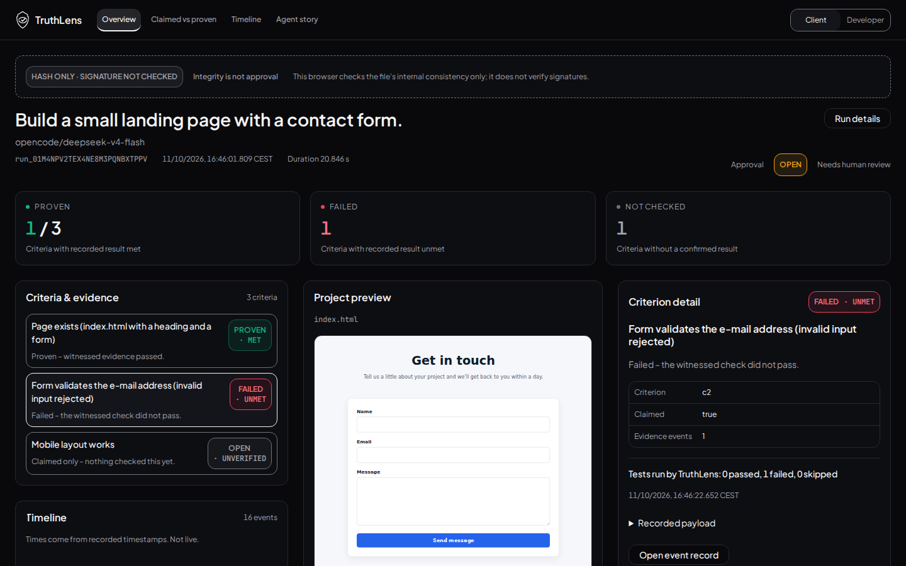
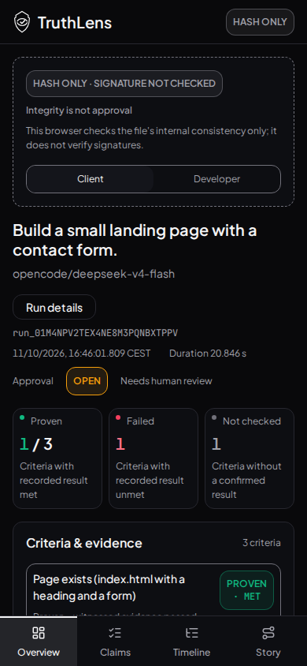

# Final Stitch colours and fonts — 2026-10-22

Shu revoked the previous WERK-only Overview direction. This evidence supersedes `../werk-colours/` for Overview. Shu confirmed these colours and fonts as final on 2026-10-22. This documentation update changes no UI code or tested assets. Other existing views retain WERK.

Tested source: `dcbf8a4e850b4e0117feeabd44d8dcd5624a9a97`, tree `02efc1d154e75462a04a7514ac3ca7834ea8acd0`. The scan started with HEAD `93f5f7f` and staged source changes; those exact changes were committed afterward. Raw metadata preserves this distinction. Evidence-only publication follows the tested source.

## Theme and licence

Overview uses central CSS variables: background #09090B, success #10B981, error #F43F5E, warning #F59E0B, neutral #71717A and neutral foreground/navigation. Plus Jakarta Sans Variable 5.3.0 is locally bundled under OFL-1.1; JetBrains Mono remains for IDs/code. AA text variants are documented in DESIGN.md. Root profile covers header and portal drawers, returns to WERK on other views and cleans up on unmount. The actual exported artifact retains its historical appearance.

## Executed validation

- Build, lint, English-language and semantic-style checks passed.
- 224 tests / 20 files passed, including theme navigation/unmount isolation.
- Both profiles: 54 contrast pairs each (108 total). All text pairs >=4.5:1; controls >=3:1 (Stitch minimum 3.77:1).
- Playwright Chromium 156.0.8078.4, axe-core 4.14.0: **36 unrestricted axe scans, zero violations**, including zero serious/critical findings. Both lenses, all four views and affected drawers/sheets at 1440×900 and 390×844. Seven keyboard scroll checks passed.
- 28 state screenshots captured; four dedicated Overview viewport/lens checks and twelve real criterion selections passed. Intermediate responsive widths checked by the screenshot script. Computed profile/font/status/navigation colours checked in browser.
- Actual artifact preview painted; opaque/inert sandbox and hostile script/form/network isolation passed; missing-body empty state passed. No unexpected browser errors. Four exact sandbox script denials retained in raw axe report as expected security enforcement.
- Independent source review found no blockers. Desktop/mobile images below were visually inspected.

Incomplete results still need manual follow-up: color-contrast in 24 scans / 551 node occurrences; aria-hidden-focus in 20 scans / 140 occurrences. These are not violations or a blanket WCAG certification. This local run does not claim hosted validation.

[Full axe results](axe-results.json) · [Computed theme and preview checks](stitch-check.json)

| Desktop 1440×900 | Mobile 390×844 |
|---|---|
|  |  |

[Actual artifact preview on mobile](preview-390-client.png). No merge without Shu’s explicit OK.
