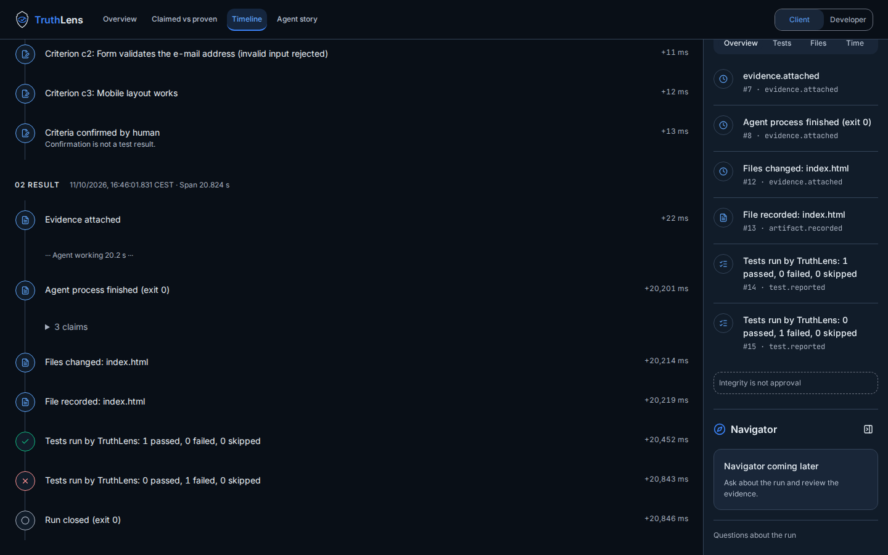
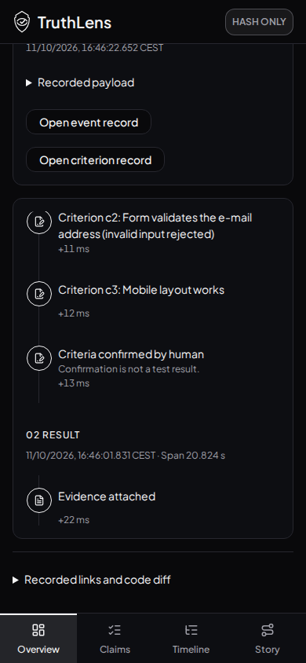

# Criteria confirmation wording — issue136 / PR137

Tested source: `961a00e083d36a663c34f12465dbc15db759b2f2`. Source tree: `ea2c2d6faa7fca15e91f8067d63468d4c83a704c`. Later changes publish evidence and update STATUS.md only.

`criteria.confirmed` now reads “Criteria confirmed by human” only for a recorded human actor, otherwise “Criteria confirmation recorded”, plus “Confirmation is not a test result.” This applies in Timeline and embedded Overview, both lenses. Misleading recorded summaries do not replace this navigation label; the exact original event/summary is still passed to its unchanged drawer. Actual passed/failed test records keep their existing presentation. No export, schema, approval-rule or integrity changes. Stitch theme/tokens preserved; other views retain their existing base.

## Executed checks

- Three new regression cases failed before implementation and passed afterward: both lenses, misleading recorded summary, actual passed/failed results, nonhuman attribution, original event reference/data retained on click.
- Full suite230 tests/21 files, lint, styles, language and production build passed. Four snapshots changed only for the new label/explanation.
- Playwright Chromium156.0.8078.4:28 existing view/sheet screenshots, plus eight focused real-export states (Overview/Timeline × both lenses ×1440×900/390×844). Confirmation visible with info tone, no old label, no page overflow/page errors. Focused desktop Timeline and mobile Overview visually inspected. Existing Stitch real-preview/selection/isolation checks passed.
- axe-core4.14.0: **36 unrestricted scans, zero violations**, including zero serious/critical. Both lenses/all four views and affected drawers/sheets at exact1440×900 and390×844. Seven keyboard focus/scroll checks passed.
- No unexpected browser errors. Four exact expected script denials retained separately: enforcement by the actual artifact's inert opaque sandbox.
- Incompletes still need manual review: color-contrast24 scans/557 node occurrences; aria-hidden-focus20/140. This is not blanket WCAG certification or a hosted-validation claim.
- Local React/interface checklist review: pure presentation change; no new hooks, data mutation or async work. Accessible button names include the visible explanation. Existing focus, data-derived times, semantic tokens, approval notice and English UI retained. No confirmed new findings.

[Full axe](axe-results.json) · [Focused states](focused-checks.json) · [Stitch checks](stitch-check.json)

| Desktop1440×900 | Mobile390×844 |
|---|---|
|  |  |

Additional screenshots in this directory cover both views and lenses. No merge without Shu’s explicit OK. PR95 untouched.
