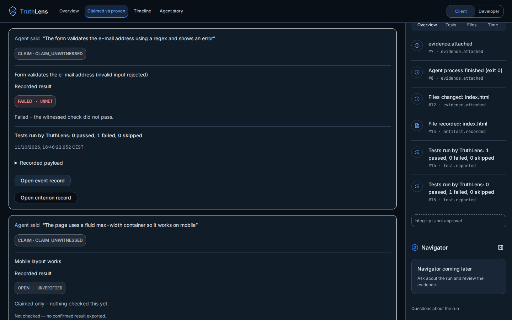
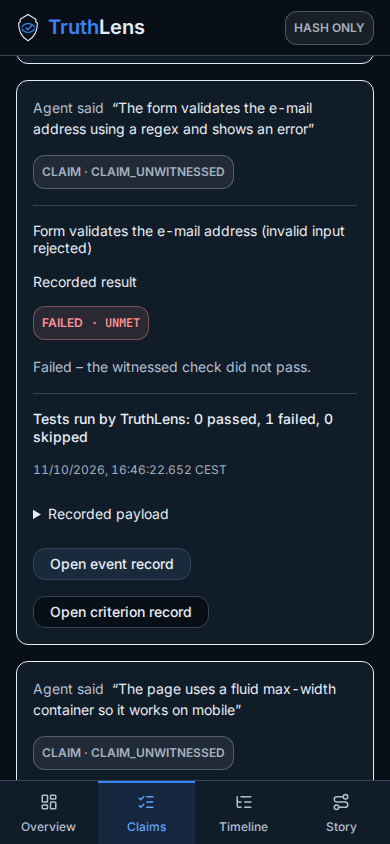
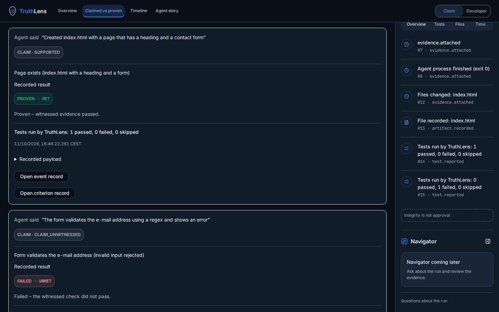
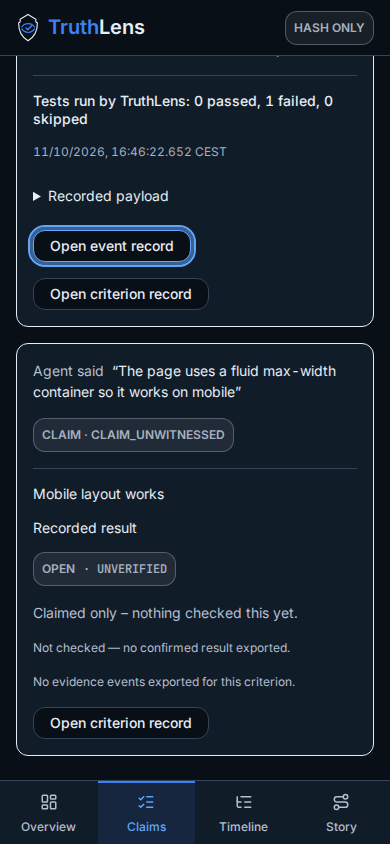
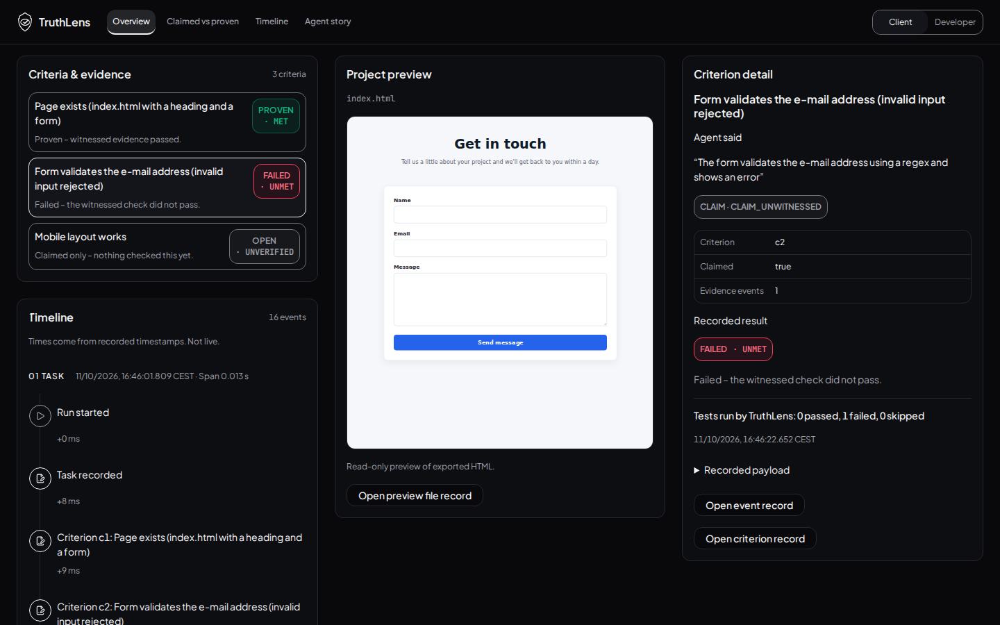
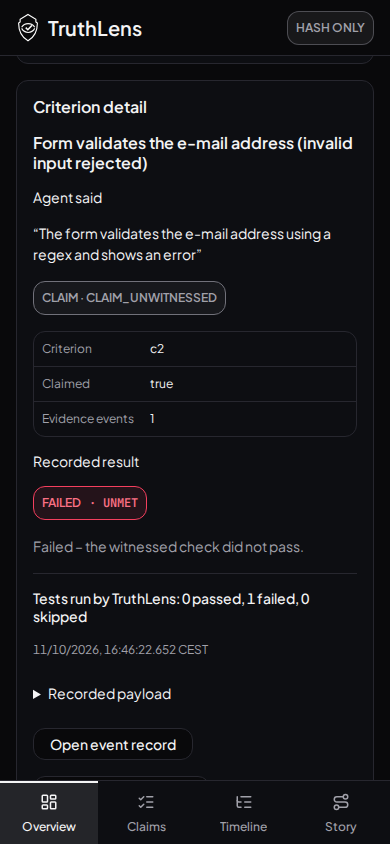

# Client claim + recorded result + evidence — issue138 / PR139

Tested UI source: `c1883d531c37b137ddaea4b6496c47b68376e21e`, tree `f203b5373f453979e9d6719bb5cb614720ee5692`. Browser scans ran against the final rendered source before its commit. Raw axe retains scan-start HEAD29e930b and adds source/tree attribution. A test-only reference assertion was corrected before the final successful suite; no rendered source changed. Later commits publish evidence/STATUS only.

## Result and boundaries

Client Claimed vs proven exposes each exported claim, linked criterion outcome and referenced evidence; no Developer switch. Overview selected detail includes every explicitly linked claim. The real demo shows c1 met / passed test, c2 unmet / failed test, c3 unverified / no exported evidence. Claim finding remains separate from criterion result. Existing Stitch layout/components/tokens/fonts and non-Overview base retained.

Joins use claim.criterion_ids and criterion.evidence event IDs exclusively. Missing criteria/events/claims are explicit, including partial references. No substitute tests based on claim findings, text similarity or chronology. Drawer callbacks preserve exact exported event identity. No schema/raw export/approval/integrity changes. UI English; hash-only and Integrity is not approval remain. PR95 untouched.

## Executed verification

- New focused regression file initially6 failures before implementation. Final suite **237 tests/22 files passed**, including7 focused cases: both lenses, actual demo outcomes, linked evidence identity, no mutation, absent/dangling links, partial/multiple criterion links and multiple claims. Updated the superseded test asserting Client hides results; four snapshots reflect the intentional display change.
- Lint, semantic styles, English-language check and build passed. Both existing profile contrast checks (108 pairs) passed.
- Chromium156.0.8078.4:28 baseline screenshots at1440×900/390×844, both lenses/four views and sheets. Existing Stitch selection/painted-preview/isolation checks passed.
- Focused real-data Client checks: **12 states** (Overview/Claims × c1/c2/c3 ×1440×900/390×844), correct claims/status/evidence, no page overflow/errors, lens remains Client. Existing event drawers open and Escape returns focus to exact trigger. Missing evidence exposes no event button.
- axe-core4.14.0: **36 unrestricted baseline scans +8 additional unrestricted event-drawer scans =44 scans, zero violations**; seven baseline keyboard scroll checks passed. Baseline both lenses/all four views and affected drawers/sheets; additional Client drawers cover real c1/c2 in both affected views/sizes. Raw additional scans included in client-checks.json.
- No unexpected browser errors. Four expected exact blocked-script messages from the real artifact sandbox retained separately in raw baseline report.
- Baseline incompletes: color-contrast24 scans/561 node occurrences; aria-hidden-focus20/140. Additional drawer incompletes recorded in client-checks.json. Manual follow-up remains; no blanket WCAG or hosted-validation claim.
- Independent code review found no blockers. Its coverage suggestion for multiple/partial references was implemented and passed. Local React/interface review: pure ID-based derivation, no new hooks/async state, preserved original data, stable record keys and real buttons; status uses text plus colour. Focus return tested. Desktop/mobile Claims/Overview screenshots visually inspected.

[Full baseline axe](axe-results.json) · [Focused Client checks and additional axe](client-checks.json) · [Stitch checks](stitch-check.json)

| Desktop1440×900 | Mobile390×844 |
|---|---|
|  |  |
|  |  |
|  |  |

All three Claims states at both sizes and failed-event drawers are published alongside this report. No merge without Shu’s explicit OK.
