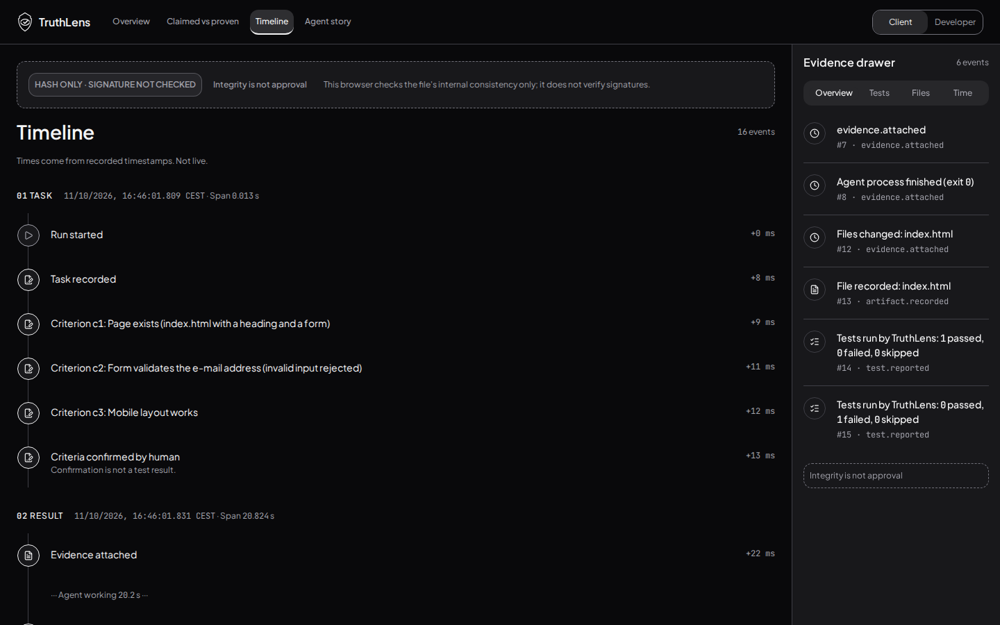

# Anti-AI-slop follow-up — PR141

Source `d0b5cf1f08436a67b01f89199b154e1328dbd614`, tree `5f9ba84a0ce6cf56f1b20e015c0e97cc28506f7f`. Raw report preserves scan-start HEAD and adds exact staged-source attribution. This is the latest rendered theme evidence; earlier after-images remain historical.

Own binding DESIGN.md section: no gradients/glow/glassmorphism, decorative icons or emoji; semantic success/failure/open colours only; one primary job/view, fewer cards/whitespace,8px scale, JetBrains numeric glyphs and factual English. Existing neutral palette/AA/focus rules unchanged. Removed inactive Navigator from visible EvidenceRail and its decorative Compass/Send graphics from the legacy standalone component. Functional navigation/event/status/close icons retained. Raw exported artifact content is not restyled.

Numerals use a digit-only JetBrains font-face before Jakarta, so original text/numbers remain unchanged; numeric fields/time use --mono directly. Actual Chromium CSS.getPlatformFontsForNode confirms JetBrains glyphs in KPI numbers and mixed prose containing digits, with Jakarta for prose letters, at both exact widths. This is glyph evidence, not just a computed font-family string.

Executed:246 tests/22 files, lint/styles/language/72 contrast pairs/build passed. Four new guard cases reject token-colour gradients, backdrop blur, drop-shadow and emoji; existing colour guard retained.28 screenshots, both lenses/all4views at1440×900/390×844 plus responsive probes;16 core images published here.36 unrestricted axe scans: zero violations; seven keyboard checks. No unexpected browser errors; exact expected artifact sandbox script denials retained separately. No Navigator placeholder/overflow in any view. Incompletes recorded in raw JSON remain manual follow-up; no blanket WCAG or hosted certification.

[Full axe](axe-results.json) · [Actual font glyph checks](font-checks.json)

| Desktop | Mobile |
|---|---|
|  |  |

Other view/lens images follow the same filenames. Functional status and navigation icons convey meaning; no new decorative icons, semantic colours, gradients or marketing copy introduced. PR143 applies this same base and the stricter fewer-cards Story list. No merge without Shu’s explicit OK.
