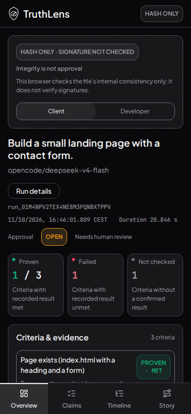

# Main integration after PR139 squash

Source `50a9ecf681baf38afbcdef140f0afe9fa7fba018`, tree `c37b77297b1b8514f649c78bc72890f145b80017`. Merges main31dbf35 into PR141 without rewriting history. Design sections combined; snapshots regenerated from the real rendered Client-results UI plus unchanged Stitch focus classes. No new behaviour or theme changes.

253 tests/23 files, lint, language/styles/72 contrast pairs and build passed.28 screenshots covering all4views/both lenses at1440×900/390×844 and sheets/responsive probes.36 unrestricted axe scans:0 violations,7 keyboard checks, no unexpected browser errors; expected inert-artifact script denials separate. Incomplete results remain recorded manual follow-up, not a WCAG certification. Real preview/criterion browser assertions passed. Earlier theme evidence remains historical.

[Full axe](axe-results.json)

| Desktop1440×900 | Mobile390×844 |
|---|---|
|  |  |

No merge without Shu’s OK.
