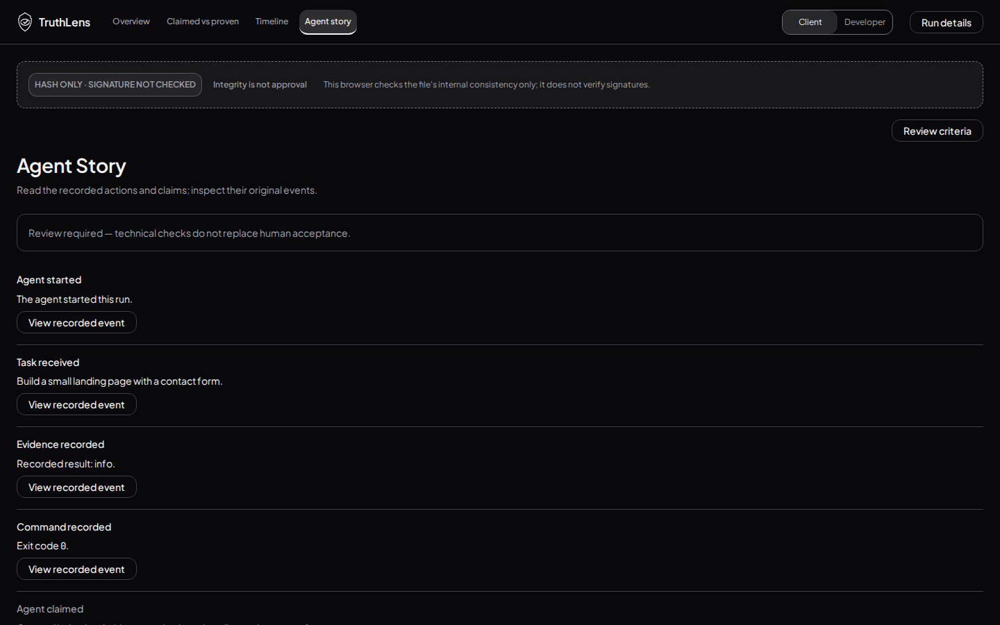
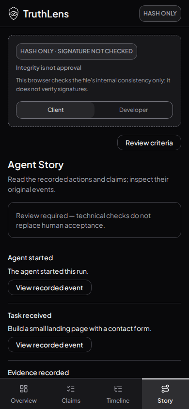

# Anti-AI-slop follow-up — PR143

Tested source `2becee26d921a3604987f1b6dc063055d44fc03b`, tree `d0e66e067d8f8fe96c38123560f3f9c96cdf33ca`. Raw axe records this source HEAD; later publication changes only evidence and STATUS. Includes PR141 head `7555afcff792142d9e76faf8763dadf36b31d53e`; PR139 unchanged. No main merge.

The own binding Anti-AI-slop section originates in the colour PR141 and applies here too. No gradients/glow/glass/decorative icons/emoji; status colours carry recorded success/failure/open meaning; neutral code-change +/- markers. One primary purpose per view, shared 8px/type tokens and factual English. All numeric glyphs use JetBrains Mono, prose letters Plus Jakarta Sans. Actual Chromium font glyph checks confirm both at1440×900 and390×844, rather than relying only on computed CSS.

Story now uses one chronological divided list with shared record actions, instead of a card per event. Original exported events, claims, criteria, evidence, schema and approval/integrity rules are unchanged. The inactive Navigator is absent; functional navigation/event/status/close controls remain. Raw artifact HTML/CSS is not repainted.

Executed:262 tests/24 files, lint, language/styles/72 contrast pairs and production build passed. Four new guard cases reject gradients, backdrop blur, drop-shadow and emoji.28 screenshots covering all4views/both lenses at1440×900/390×844 plus sheets/responsive probes;16 core images published here.36 full unrestricted axe scans:zero violations;7 keyboard scroll checks; no unexpected browser errors. Exact expected artifact sandbox script denials recorded separately. Twelve actual keyboard result→criterion→evidence paths and twelve return paths pass, plus3 explicitly synthetic invalid/error/empty fixtures. All four views have no horizontal overflow at both exact widths.

Axe incomplete results remain manual follow-up in raw JSON; no blanket WCAG, user-study or hosted deployment certification. Previous before/after reports remain historical; this is the latest after evidence.

[Full axe](axe-results.json) · [Actual font glyphs](font-checks.json) · [Keyboard paths](flow-checks.json)

| Story desktop | Story mobile |
|---|---|
|  |  |

Other view/lens images use overview/claimed/timeline/story and1440/390,client/developer filenames. No merge without Shu’s explicit OK.
