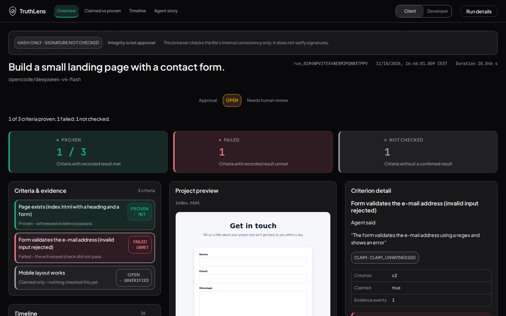
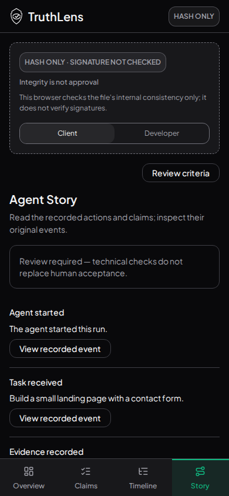

# URL branch integration after owner PR143 squash

Tested source `78681d8d90de41d01f0e8c2354e01643eb729748`, tree `1b2bc16600e060e2f1fc0ce9f965dfabac09b166`. Main6c66473 (owner PR143 squash, including status accents) merged into PR145 without force-push. The URL hook, its9 tests and browser script remain byte-identical to f746054. The independent URL change now inherits the shared Stitch shell/accents; no feature/data/schema/approval changes. Previous integration reports remain historical.

272 tests/25 files, lint, language/styles/116 contrast pairs/toolbar gate and build passed. Real Chromium:16 direct/reload/copied-URL cases plus4 keyboard/history/fallback cases at1440×900/390×844, both lenses.28 review captures/real criterion and static-preview assertions passed;16 core images published here.36 unrestricted axe scans:zero violations,7 keyboard scroll checks, no unexpected browser errors; expected inert-artifact script denials separate. Incomplete results remain manual follow-up; no blanket WCAG/hosted claim.

[Full axe](axe-results.json) · [URL checks](view-url-checks.json)

| Desktop | Mobile |
|---|---|
|  |  |

Other images:overview/claimed/timeline/story-1440/390-client/developer.png. PR143 was merged by the owner during this work; no agent PR merge. PR95 untouched.
