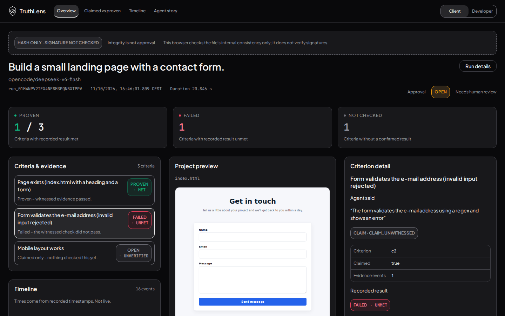
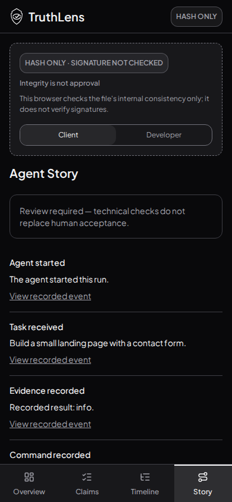

# URL branch integration after PR141 squash

Tested source `69063da2b14870ef96edd7b79ab8fb71a52b1884`, tree `d5b6f0d6a12ccaa24205d33e4c3d8f5734a433ac`. Maincc9929e merged into PR145 without force-push. Design sections combined; App uses the existing URL hook while inheriting the single Stitch theme from main. URL hook, its9 tests and browser script are byte-identical to f746054; no feature/data/schema/approval changes. Old reports below remain historical; this is the latest rendered UI.

262 tests/24 files, lint, language/styles/theme contrast/toolbar gate and build passed. Real Chromium:16 direct/reload/copied-URL cases plus4 keyboard/history/fallback cases at1440×900/390×844, both lenses.28 review captures and real criterion/preview checks passed;16 all-view images published here.36 unrestricted axe scans:zero violations,7 keyboard scroll checks, no unexpected browser errors; expected inert-artifact script denials separate. Incomplete results remain recorded manual follow-up, not a WCAG certification. No hosted claim.

[Full axe](axe-results.json) · [URL checks](view-url-checks.json)

| Desktop | Mobile |
|---|---|
|  |  |

All4views/both lenses use overview/claimed/timeline/story-1440/390-client/developer filenames. PR143 is separately current on main and untouched by this integration; PR95 untouched. No agent PR merge.
